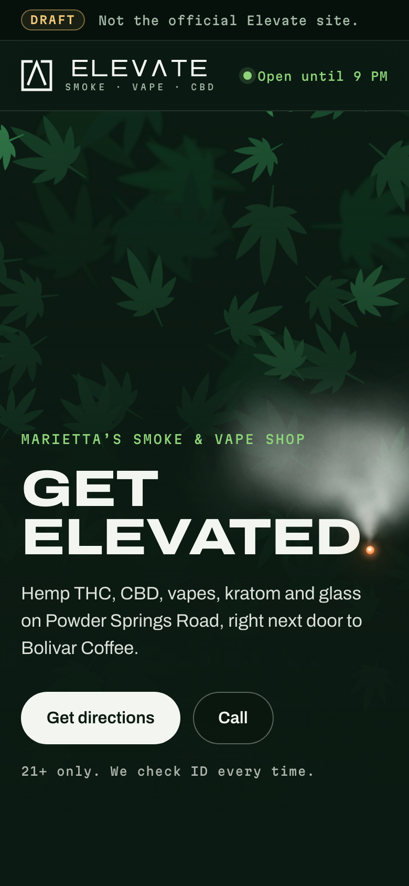
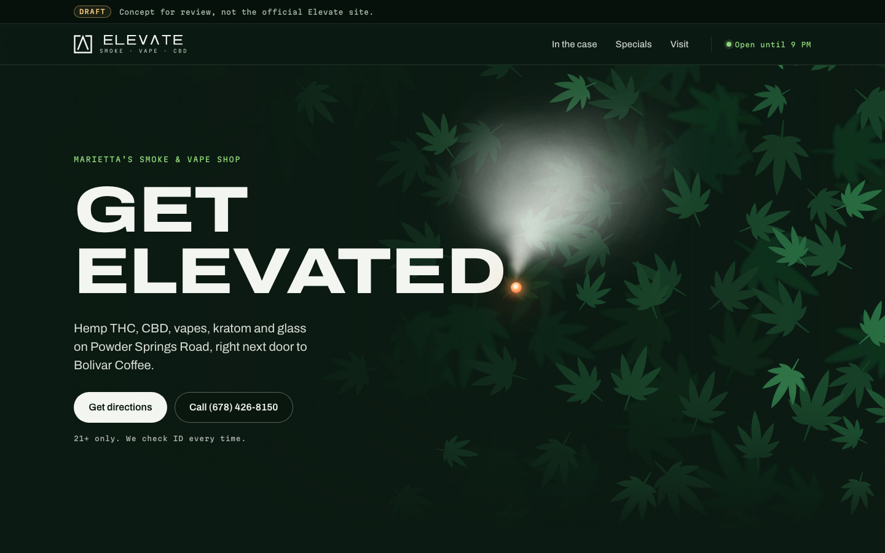

# Elevate Smoke, Vape & CBD: website draft

A one-page website concept for Elevate Smoke, Vape & CBD, Spring Square, Suite 3, 1651 Powder Springs Rd SW, Marietta, GA 30064, in the same plaza as Bolivar Coffee.

**Status: draft for review.** Preview: https://evanmcdowell31.github.io/elevate-site/ (GitHub Pages, from `docs/` on `main`). Every page view shows a draft banner, and `noindex` keeps it out of search engines. It is not the shop's official site, which is elevatesmoke.shop.

| Phone | Desktop |
| --- | --- |
|  |  |

More in `review/`: the age check, the visit section, and both full pages.

## The idea

Elevate means getting elevated. The headline says it: "Get elevated." Its full stop is a lit ember, and smoke curls up from it across a wall of leaves.

The look comes from the shop's storefront: a white, wide ELEVΛTE wordmark (the A has no crossbar) with SMOKE · VAPE · CBD beneath, on a living wall of green leaves. The wordmark and mark here are traced from Street View for the draft, so swap in the shop's own logo files. Colours: deep leaf green, sage, a fresh leaf green, white, and one warm accent, the ember.

The type is Archivo, in its expanded cut for headlines (after the sign) and its normal cut for text, plus Martian Mono for labels. Both are served from `docs/fonts/` under the SIL Open Font License (license files alongside), so the page loads nothing from other servers.

## What's on the page

- A 21+ age check before the site opens. A yes is remembered on that device.
- "Open until 9 PM" or "Closed" in the header, worked out from the shop's hours in Marietta time. Today's hours and today's special are marked.
- What's in the case, led by hemp THC (delta-8, delta-9, THCA: flower, pre-rolls, vapes, gummies), then CBD, vapes, kratom, glass, hookah, papers and gear. The vape card carries the FDA nicotine warning.
- "Higher standards": lab reports on request and staff who know their stuff, as their reviews say.
- Sample weekly specials, on accessories only.
- Directions (Google Maps and Apple Maps), tap to call, and a sketch of Spring Square with Elevate beside Bolivar Coffee.
- The hemp, FDA, impairment and nicotine notices in the footer.
- On phones, a Directions and Call bar appears once the top buttons scroll away.

## Preview and screenshots

```sh
python3 -m http.server -d docs 8000   # open http://localhost:8000
node tools/shoot.mjs                  # re-renders review/*.png and docs/og.png
```

Add `?nogate` to the address to skip the age check, and `?still` to stop the motion. The screenshots use both. `tools/shoot.mjs` drives Playwright's cached headless Chromium shell, with no window.

## Before it could go live

- [ ] The shop's logo files, photos of the counter and the glass, and their real specials.
- [ ] Confirm the phone number. Their website and the listings say (678) 426-8150, but the LED on the Spring Square sign (in Street View) shows (678) 928-7522.
- [ ] Confirm the hours, and which side of Bolivar Coffee the storefront is on. The plaza sketch is a guess.
- [ ] Check the THC line-up against federal law. Synthetic cannabinoids such as THC-O lose hemp status on 12 November 2026, and most hemp-THC products on 11 December 2026 unless Congress acts again.
- [ ] Remove the draft banner and `noindex`, add schema.org `Store` data, and point elevatesmoke.shop at the site.

## Sources

- Address, suite, phone and hours: public listings (MapQuest, Yahoo Local, Roadtrippers, CannabisShop.com), read 2026-11-08.
- Storefront, Spring Square sign and logo: Google Maps Street View, used only as a reference and not copied into the site.
- What reviewers value: CannabisShop.com reviews, 2023–2024.
- Hemp dates: CNN (3 November 2026) and the Cannabis Law Blog, on the delay signed 2 September 2026.
- Fonts: Google Fonts, SIL Open Font License 1.1.
